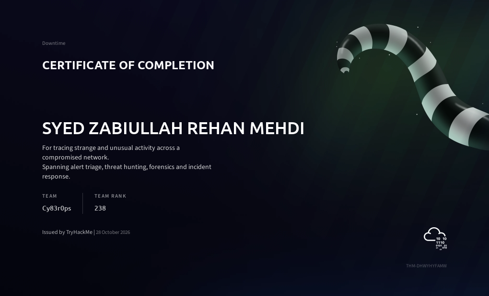
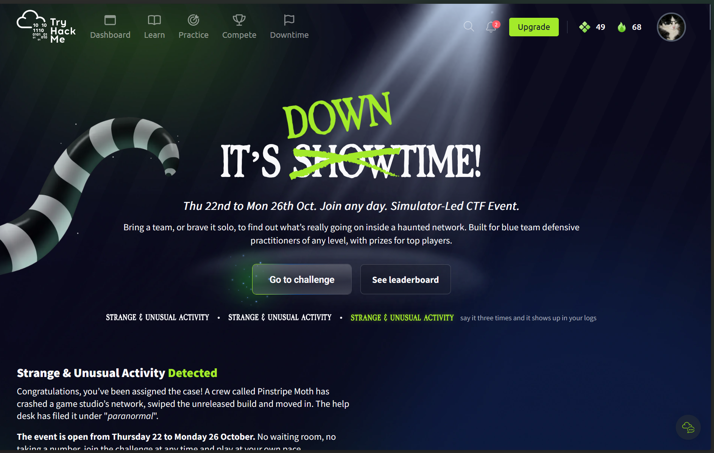
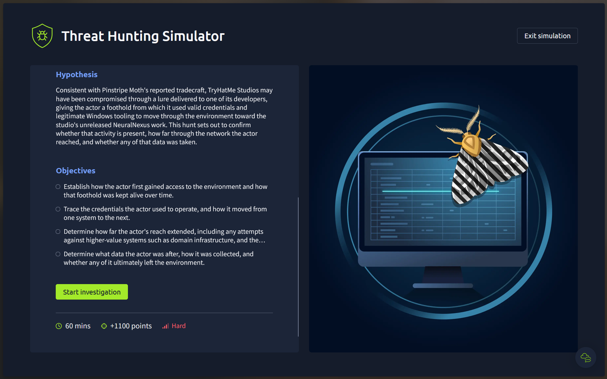
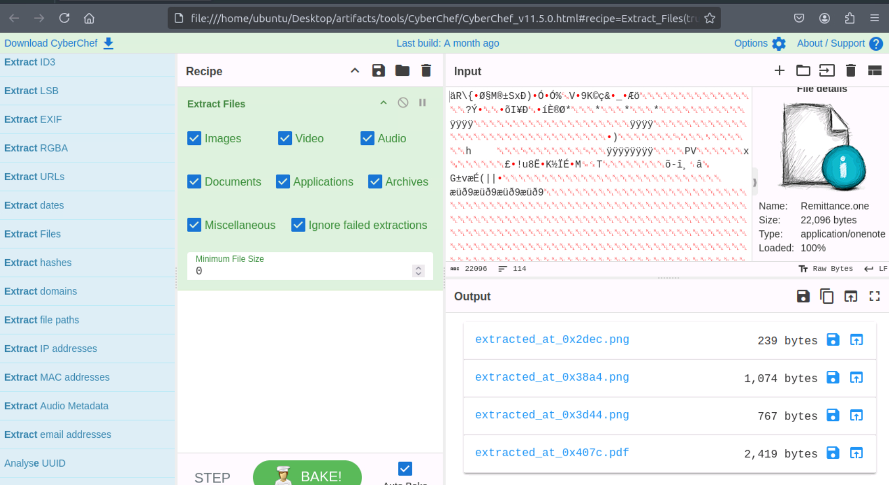
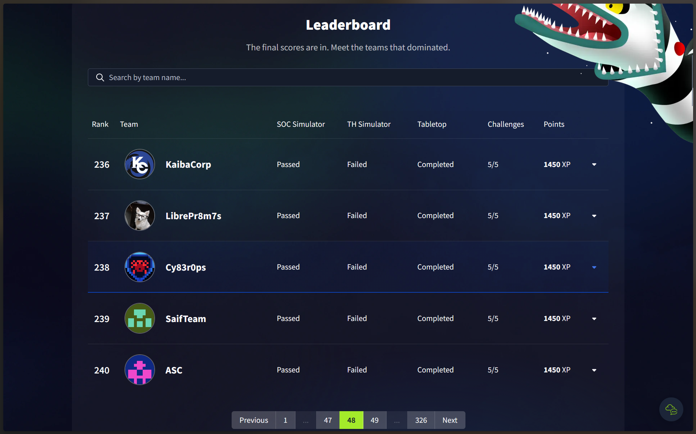

# TryHackMe: The Downtime! (Simulator-Led CTF)

**Event Date:** Oct 22 - Oct 26, 2026  
**Team:** Cy83r0ps  
**Rank:** 238 (Score: 1450 XP)  
**Focus:** SOC Simulation, Threat Hunting, Forensics, Incident Response  

I have just completed TryHackMe’s downtime CTF which is a 5 day blue team challenge. Our team Cy83r0ps placed 238th out of 1627 teams. This meant we were in the top ~15%. We had to investigate a breach on a game studio using an SOC simulator, threat hunting simulator, tabletop and 5 CTF challenges. We completed the SOC simulator, tabletop and all 5 challenges. 

Key takeaways were working as a team rather than trying to do everything yourself and making sure you read the question properly. 
Thanks to my teammates and TryHackMe for a great event!

## Event Gallery

| | |
|:---:|:---:|
|  |  |
|  |   |
